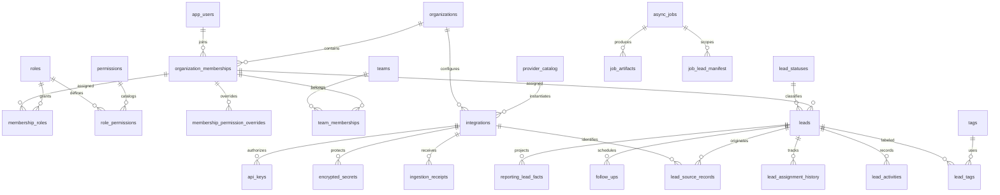

# Lead-centric CRM: database, backend and frontend architecture

**Design baseline:** 4 November 2026  
**Deployment:** multi-tenant SaaS, PostgreSQL; [Docker infrastructure only](DOCKER-SETUP.md), backend/frontend run locally from source  
**Scope:** a design specification, not a claim that the existing prototype implements these features.

The companion [PostgreSQL schema](database-schema.sql) is the authoritative reference DDL for this design. Convert it into reviewed Alembic migrations during implementation; do not apply it on top of the application's Alembic-managed schema.

**Implementation status:** the [single CRM backend](../backend/README.md) now
implements the versioned API at port 8000 through `app.main:create_app --factory`,
connection/settings infrastructure, and a
five-table Alembic baseline for users, organizations, memberships, statuses and
organization settings. Migration `0002_identity` adds permissions, custom roles,
membership grants/overrides, hashed invitations, rotating server-side sessions,
organization lookup, persistent abuse counters and access audit. Onboarding,
authentication and protected role/membership APIs are implemented. This increment
uses opaque session cookies rather than the proposed access-JWT layer; refresh
rotates within a fixed session expiry and detects replay.
Migration `0003_leads` implements PostgreSQL leads, tags/simple custom fields,
own/team/all-scoped reads and writes, redaction, keyset pagination, optimistic edits,
archive/restore, team membership, dashboard aggregates and organization profile updates.
The authenticated frontend uses only this API and all runtime storage uses PostgreSQL.
Migration `0015_repeat_customers` records the first conversion time and marks a
later enquiry as a repeat customer when an earlier visible converted lead shares
a normalized phone number or email. The flag is withheld without contact-data
permission. This is a contact match, not proof of a separate purchase. Existing
conversions are recovered from current won statuses and history whose status name
still matches a won status; older renamed or unrecorded conversions may be missed.
Migration `0004_role_hierarchy` adds a tenant-bound reporting parent and per-user
landing preferences. User management is centralized at `/users` with Users,
Teams (Owner-only), Roles and Permissions tabs, gated by existing access.
Type and level are derived from the reporting tree: no parent means Parent/Level 1,
and each reporting edge adds one level. A Child can itself have children.
Reporting does not inherit page permissions or expand lead visibility. Role
mutations serialize on the organization lock and reject cycles and foreign-tenant
parents. Group Select all respects the caller's grant ceiling; Clear removes role
grants or resets direct overrides to role defaults. Landing preferences are checked
against the resulting access when saved; sign-in falls back to an accessible page
if permissions were later revoked. `/account` always remains available.
Marketplace workers, reports/exports, provider credential encryption and scoped
website intake are implemented in the application. Lead response activities are
manually logged, actor-attributed events; they are not inferred from status changes
or verified by communication providers. MFA, password recovery, email verification
and delivery remain future work. The proposed large-data/concurrency targets below
are not measured capacity.
Do not apply the full reference SQL on top of the Alembic-managed schema.

## 1. Product scope and decisions

### Included features

| Module                     | Features                                                                                                                                                                    |
| -------------------------- | --------------------------------------------------------------------------------------------------------------------------------------------------------------------------- |
| Organizations              | Registration, protected initial Owner, organization profile, timezone, settings, suspension, organization switching                                                         |
| Identity                   | Login, invitation acceptance, verification, password recovery, sessions, optional MFA, recovery codes                                                                       |
| Users and access           | Multiple memberships, multiple roles, page/action permissions, direct allow/deny overrides, own/team/all data scope, explicit lead sharing                                  |
| Leads                      | Consolidated table, details, typed custom fields, tags, saved views, search/filter/sort, assignment, status changes, remarks, follow-ups, activity history, archive/restore |
| Marketplace and API intake | Provider catalog, encrypted credentials, field mappings, raw receipts, pull/webhook adapters, test connection, durable intake, retries, backfill, idempotency               |
| Assignment                 | Manual/bulk assignment, round robin, least open leads, fixed recipient, source/marketplace conditions, no-eligible-user fallback                                            |
| Reports                    | Source/status/user/time/conversion/aging/unassigned/follow-up reports, drill-down, CSV/Excel download jobs, Download Center                                                 |
| Analytics                  | Permission-filtered KPI cards, trends, comparisons, connector health, recent leads, freshness indicators                                                                    |
| Developer tools            | Scoped API keys, generated API documentation, intake status, API activity, outbound signed webhooks                                                                         |
| Operations                 | Immutable application audit trail, observability, quotas, backups, retention, replay, dead-letter management                                                                |

Not included: inventory, invoicing, billing implementation, campaigns, quotations, or a full opportunity pipeline. Firebase push delivery and audience/campaign messaging are not lead-marketplace features and are outside the initial release.

### Resolved design decisions

1. One PostgreSQL lead model for every source; no provider-specific lead databases.
2. Global user identity, organization-specific memberships and authorization.
3. Owner is a protected membership capability, not a customizable ordinary role.
4. Cursor pagination for large tables; no arbitrary deep page numbers.
5. JSONB is the canonical custom-value store; typed definitions/options are relational.
6. External source identity is unique independently of received time.
7. Asynchronous, bounded exports and bulk operations.
8. Tenant isolation is enforced in application queries AND PostgreSQL RLS.
9. A modular monolith, not microservices, with separately scalable worker processes.
10. Local Docker Compose for PostgreSQL/Redis only. Backend/frontend/migrations/workers run from source outside Docker; managed infrastructure and separately deployed application processes in production.

## 2. Capacity assumptions and measurable targets

These are proposed acceptance targets, not benchmark results or hosting guarantees. Confirm them against expected customer usage before procurement.

| Dimension                  | Initial sizing/test baseline                                                                                      |
| -------------------------- | ----------------------------------------------------------------------------------------------------------------- |
| Organizations              | 100 active organizations, deliberately uneven distribution                                                        |
| Memberships                | 10,000 total, 500 simultaneously active users                                                                     |
| Lead data                  | 10 million total; at least one organization with 1 million                                                        |
| Interactive traffic        | 100 requests/second sustained; 250/second bursts                                                                  |
| Intake                     | 50 accepted lead events/second sustained; 200/second bursts with queue buffering                                  |
| Default table request      | p95 <= 300 ms server time for 50 rows, excluding a separate exact-count operation                                 |
| Indexed supported searches | p95 <= 750 ms on the documented representative query set                                                          |
| Cached analytics           | p95 <= 500 ms; uncached bounded analytics <= 2 seconds or become async                                            |
| Accepted webhook           | p95 <= 500 ms after validation and durable receipt commit, excluding provider latency                             |
| Intake freshness           | 95% of accepted events processed within 60 seconds under sustained test load                                      |
| Dashboard freshness        | Normally <= 60 seconds behind processed changes; show actual watermark                                            |
| Exports                    | Default cap 1 million contributing leads; 2 active exports/organization; 1 active heavy export/database initially |
| Availability goal          | 99.9% monthly for the hosted service, dependent on the selected infrastructure                                    |
| Recovery targets           | RPO <= 5 minutes, RTO <= 60 minutes, demonstrated by restore drills                                               |

500 active users does not mean 500 database connections. Browser inactivity, request duration, connection pools, and worker backpressure determine actual database concurrency.

### Starting production resources to benchmark

- Database: managed PostgreSQL 16+ primary, 8 vCPU, 32 GB RAM, SSD storage starting at 500 GB with monitored growth. Storage sizing includes indexes, WAL, vacuum headroom and temporary reporting data; measure actual bytes/lead.
- API: two Linux hosts/process groups, two Uvicorn processes each, starting at 2-4 vCPU and 4-8 GB RAM per host.
- Workers: two intake workers, one reporting/export worker, one lightweight scheduler/relay group. Keep heavy exports away from API processes.
- Redis: managed Redis-compatible endpoint with persistence for queues, starting at 2 GB; separate cache and queue instances in production if cache eviction threatens job reliability.
- Private S3-compatible object storage for imports, exports and oversized raw payloads.
- Frontend: two stateless Next.js instances or a suitable managed Node.js service.

Start smaller in development. Scale only after query profiling and mixed-load tests. CPU, storage latency, payload size, tenant skew and custom-field filters materially change these estimates.

## 3. Technology selection

| Layer             | Technology                                                             | Purpose and constraints                                                                              |
| ----------------- | ---------------------------------------------------------------------- | ---------------------------------------------------------------------------------------------------- |
| Frontend          | Existing Next.js App Router, React, TypeScript                         | Preserve the prototype stack; use supported patched releases and lock dependencies before production |
| UI                | Tailwind CSS, shadcn/ui, accessible Radix-based primitives             | Responsive forms, dialogs, tables and permission editor                                              |
| Server data       | TanStack Query                                                         | Request caching, cancellation, invalidation, cursor lists, job polling                               |
| Table             | TanStack Table + TanStack Virtual                                      | Server-side filtering/sorting, column layouts and bounded rendering                                  |
| Forms             | React Hook Form + Zod                                                  | Client validation; backend remains authoritative                                                     |
| Charts            | Recharts                                                               | KPI/trend/source/status charts with tabular accessible alternatives                                  |
| API client        | OpenAPI-generated TypeScript types                                     | Avoid frontend/backend contract drift                                                                |
| Backend           | Python 3.12+, FastAPI, Pydantic v2, Uvicorn                            | Typed modular HTTP API; use asynchronous I/O                                                         |
| Persistence       | SQLAlchemy 2 async + psycopg 3 async                                   | Explicit transactions and typed repositories                                                         |
| Migrations        | Alembic                                                                | Reviewed, versioned schema and data migrations                                                       |
| Database          | PostgreSQL 16+                                                         | Transactions, composite FKs, JSONB, full-text search, RLS                                            |
| Connections       | PgBouncer transaction pooling                                          | Bounded server connections; all request context uses transaction-local settings                      |
| Workers           | arq + Redis                                                            | Async intake, exports, retry dispatch; PostgreSQL tracks durable state                               |
| Provider HTTP     | httpx                                                                  | Explicit deadlines, response validation, connection reuse                                            |
| Authentication    | Argon2id, PyJWT, standards-based TOTP library                          | Password hashing, short-lived JWTs, MFA; no home-grown cryptography                                  |
| Secret protection | cryptography AES-GCM + managed KMS                                     | Envelope encryption and key rotation                                                                 |
| Export/import     | Python csv, XlsxWriter constant-memory writer                          | Stream data; avoid loading large pandas dataframes in API memory                                     |
| Telemetry         | Structured JSON logs, OpenTelemetry, Prometheus/Grafana                | Correlation, latency, queue age, database pressure; redact PII/secrets                               |
| Validation        | pytest, HTTPX/respx, real PostgreSQL integration tests, Playwright, k6 | Contract, tenant/access, UI, failure and load tests                                                  |

Redis is not officially a native Windows server deployment target. For Docker-free Windows development, use a managed Redis-compatible service or Redis in WSL2 if permitted. PostgreSQL, Python and Node.js run natively on Windows. Do not rely on an obsolete unofficial Redis Windows build.

## 4. High-level architecture

```text
Browser
  -> TLS reverse proxy / load balancer
      -> Next.js: layouts, authenticated UX, typed API client
      -> FastAPI: identity / permission / visibility checks
          -> PostgreSQL primary: business state, receipts, outbox, jobs
          -> Redis: queues, rate limits, permission-safe short-lived cache
          -> private object storage: imports, exports, large payloads

Provider webhook -> ingress authentication -> durable receipt + outbox -> 202
Provider pull    -> scheduler -> leased connector request -> durable receipts

Outbox relay -> Redis notifications -> intake worker -> centralized lead service
                                    -> analytics worker
                                    -> outbound webhook worker
                                    -> export / import / bulk worker
```

The database remains the source of truth when Redis is unavailable. An accepted durable receipt stays discoverable; periodic reconciliation requeues pending receipts/jobs. Redis notification delivery alone is not proof of completion.

## 5. Database architecture

### 5.1 Conventions and boundaries

- 57 reference tables. Tenant-owned rows use `org_id`; entity keys are UUIDs.
- Most tenant entities use `PRIMARY KEY (org_id, id)`. Every tenant-bound relationship carries `org_id` in its foreign key.
- UUIDs prevent convenient enumeration but do not grant authorization. Resolve every public ID inside the authenticated organization.
- Global identity/control tables are accessible only to dedicated identity/platform roles, not ordinary tenant handlers.
- All timestamps are `timestamptz`; persist UTC instants. Validate IANA timezone names at the service boundary.
- `updated_at` and audit metadata are written by services. The leads trigger increments `row_version` and updates its timestamp on every update.
- Non-null IDs, positive-limit checks, enum-like checks, unique mappings, and composite FKs are implemented in the DDL.
- JSONB is only for validated configuration/custom data, not arbitrary SQL expressions or executable code.
- Organizations, memberships, roles, statuses and integrations normally deactivate instead of being deleted. Most FKs intentionally RESTRICT deletion.

### 5.2 Relationships



### 5.3 Identity, membership and permissions

| Table                                    | Important fields / invariant                                                                               |
| ---------------------------------------- | ---------------------------------------------------------------------------------------------------------- |
| `app_users`                              | Global normalized unique email, Argon2id password hash, verification time; no organization-level role here |
| `organizations`                          | Unique slug, lifecycle/subscription state, plan dates, export window, user cap, profile and auth generations |
| `organization_directory`                 | Minimal slug-to-organization routing; no lead/profile data                                                 |
| `platform_operators`                     | Separate platform capability, not an organization role                                                     |
| `platform_sessions`, `platform_audit_logs` | Separate operator sessions and actor-attributed platform administration history                            |
| `organization_memberships`               | Unique organization/user pair, active/invited/disabled, protected `is_owner`, optional visibility override |
| `roles`                                  | Organization-defined name and default own/team/all scope                                                   |
| `permissions`                            | Global module/page/action catalog with delegability flag                                                   |
| `role_permissions`                       | Tenant-bound role-to-permission relation                                                                   |
| `membership_roles`                       | Multiple roles per organization membership                                                                 |
| `membership_permission_overrides`        | Explicit allow/deny per permission, including who changed it                                               |
| `teams`, `team_memberships`              | Organization-scoped team membership                                                                        |
| `organization_settings`                  | MFA requirement, retention, export quotas, duplicate/security policy                                       |
| `auth_sessions`                          | Membership-bound session, refresh family, MFA verification, expiry/revocation                              |
| `session_refresh_tokens`                 | Hashed refresh-token history, consumed markers for reuse detection                                         |
| `auth_tokens`                            | Hashed, expiring, one-time email verification/password reset tokens                                        |
| `organization_invitations`               | Hashed invitation token tied to the exact membership                                                       |
| `user_mfa_factors`, `mfa_recovery_codes` | Encrypted verified TOTP factors and hashed one-time recovery codes                                         |

The Owner is granted every organization permission by the permission evaluator, including future catalog additions. A custom role cannot remove Owner access. Only an existing Owner may grant/revoke Owner capability.

The schema serializes membership/status administration by updating an organization administration generation and uses deferred constraints to prevent an active organization losing its last active Owner or default status. This is a real row update, not only a row lock, so concurrent snapshot-isolation administration produces a serialization conflict instead of permitting write skew. Onboarding creates the organization, membership, default statuses and settings in one transaction, then activates it. Status replacement clears the old default and sets the new one within a single transaction.

### 5.4 Lead model and customization

| Table                      | Purpose / invariant                                                                                                                                         |
| -------------------------- | ----------------------------------------------------------------------------------------------------------------------------------------------------------- |
| `leads`                    | Canonical lead record; contact information, status, source, assignment, received time, JSONB custom values, field provenance, archive/delete state, version |
| `lead_source_records`      | Unique `(org_id, integration_id, external_id)` independent of received timestamp; multiple source identities can point to one reviewed merged lead          |
| `lead_statuses`            | Active/default flags, ordering and stable new/pending/working/won/lost category                                                                             |
| `custom_field_definitions` | Immutable field key/type after use, required/filterable/listing/sensitive flags, validation and definition version                                          |
| `custom_field_options`     | Stable option keys, labels, ordering and deactivation                                                                                                       |
| `tags`, `lead_tags`        | Easy organization tags, many-to-many lead tagging with reverse filter index                                                                                 |
| `lead_shares`              | Explicit expiring visibility grants to selected memberships; never grants an action permission                                                              |
| `lead_activities`          | Structured old/new changes plus notes, actor/integration, immutable lead version                                                                            |
| `lead_assignment_history`  | Previous/new member, actor/rule and assignment reason, unique by lead/version                                                                               |
| `follow_ups`               | Assigned reminder, due/completed/cancelled timestamps and row version                                                                                       |
| `duplicate_candidates`     | Ordered pairs of leads with phone/email/manual match reason and review state                                                                                |

Default statuses: New, Pending, Contacted, Qualified, Interested, Not Interested, Converted, Lost. Converted is won; Not Interested and Lost are lost. Remaining categories are explicitly configured during onboarding.

Custom values use stable keys, for example:

```json
{
  "budget": 250000,
  "business_category": "manufacturing",
  "interested_products": ["pumps", "motors"],
  "expected_purchase_date": "2026-12-01",
  "consent_to_contact": true
}
```

Values are validated against the organization's definitions for writes, intake and filters. A type/key change on a used field requires an explicit conversion migration, not an in-place rename. Deactivation preserves history. Sensitive custom values require the PII permission and are excluded from generic full-text indexes.

Contact lookup uses E.164-normalized phone and normalized email HMACs with tenant context. Plain contact values are stored in the lead row for authorized workflows and protected by database-volume/backups encryption plus application masking. This is not application-level encryption of every contact value. If column-level PII encryption is required, add encrypted contact payloads before implementation and accept the associated search constraints.

`extra_contact_data` preserves alternate phone/email/address information and provider-specific details not suitable for core columns. Provider raw payloads remain on receipts. Never expose a raw payload wholesale to ordinary lead readers.

### 5.5 Integrations and durable processing

| Table                                    | Purpose / invariant                                                                                                  |
| ---------------------------------------- | -------------------------------------------------------------------------------------------------------------------- |
| `provider_catalog`                       | Global provider capability/config contract; verification status distinguishes real adapters from placeholders        |
| `integrations`                           | Multiple named accounts per provider per organization, credential/mapping versions, lifecycle and safe health status |
| `encrypted_secrets`                      | AES-GCM envelope, nonce, wrapped data key, key reference, purpose/version and display suffix                         |
| `api_keys`, `api_key_scopes`             | Prefix, HMAC hash, pepper version, membership owner, expiry/revocation, permission scopes                            |
| `webhook_routes`                         | Random public route ID plus independent HMAC/OAuth-provider/bearer verification                                      |
| `api_key_directory`, `webhook_directory` | Minimal credential routing before tenant resolution; direct access is limited to authentication/ingress              |
| `integration_mapping_versions`           | Immutable complete mapping versions; each receipt pins the mapping used to interpret it                              |
| `connector_cursors`                      | Committed watermark, next allowed hit, generation and expiring fenced lease                                          |
| `integration_sync_runs`                  | Queued/running/success/failure windows and fetched/accepted counters                                                 |
| `ingestion_receipts`                     | Deduped delivery, request hash, raw inline/private-object payload, mapping version, retry/lease and result           |
| `outbox_events`                          | Atomic business-event publication intent with aggregate/version uniqueness                                           |
| `consumer_checkpoints`                   | Consumer/event uniqueness to make at-least-once delivery safe                                                        |

An API key's effective rights are its scopes intersected with its creator's current delegable permissions and current data scope. A disabled creator, inactive integration, expired key or revoked key fails authentication. Reassign machine integration ownership explicitly before disabling its owner; never leave an orphaned all-access key.

Routing identifiers are not secrets. Prefix/public-ID resolution only locates a candidate credential; signature/hash and current integration state checks still happen before access or intake.

### 5.6 Reporting, jobs and audit

| Table                                         | Purpose / invariant                                                                                                                       |
| --------------------------------------------- | ----------------------------------------------------------------------------------------------------------------------------------------- |
| `saved_lead_views`                            | Private/shared filter specification, columns, sort and view version                                                                       |
| `async_jobs`                                  | Export/import/bulk/report lifecycle, requester, idempotent operation key, filter and authorization snapshots, lease/progress/cancellation |
| `job_artifacts`                               | Private object key, safe file name/MIME, row/byte counts, checksum and expiry                                                             |
| `job_lead_manifest`                           | Exact contributing lead IDs/versions for restricted artifacts and download-scope rechecks                                                 |
| `reporting_lead_facts`                        | One latest projected row per lead/metric generation; version gates make out-of-order events safe                                          |
| `lead_daily_rollups`                          | Acquisition-day/source/status/assignee counts; `NULLS NOT DISTINCT` prevents duplicate unassigned groups                                  |
| `webhook_subscriptions`, `webhook_deliveries` | Outbound destination/signing configuration and unique subscription/event delivery attempts                                                |
| `audit_logs`                                  | Tenant-bound append-only redacted business/access audit                                                                                   |
| `platform_audit_logs`                         | Separate platform-operation audit; no default access to tenant data                                                                       |

The application runtime can INSERT/SELECT audit rows but cannot UPDATE/DELETE them. Retention uses a separate maintenance identity with approval. Do not place API keys, raw request bodies, passwords, session tokens or unrestricted contact history in audit changes.

### 5.7 Index and storage strategy

The reference DDL includes:

- Partial list indexes on `(org_id, received_at DESC, id DESC)` for active, non-deleted leads.
- Status/assignee/source indexes followed by the same pagination order.
- Exact phone/email lookup indexes and stable external-identity lookup.
- Full-text GIN over name/company/product/city; no phone/email in that index.
- JSONB GIN for supported containment predicates, not a claim that it accelerates every numeric/date range.
- Reverse tag/team/share indexes and activity/follow-up timeline indexes.
- Pending-work indexes for receipts/outbox/jobs/webhook delivery.

For frequently queried numeric/date custom fields, add approved typed expression indexes after validating existing values, or introduce a typed search projection. Do not cast arbitrary JSON to numbers in live queries or create an index for every customer-defined field. Set a per-organization indexed-field quota and monitor index size/write cost.

**Partitioning decision:** keep leads unpartitioned initially to retain global-within-tenant UUID and external-identity integrity with straightforward FKs. Ten million rows alone does not force partitioning. First partition high-growth append-only history/raw-event data when retention/maintenance measurements justify it. Such migrations must include the partition key in primary/foreign keys or use a stable registry; they are not silently assumed by this baseline.

If lead partitioning becomes necessary, prefer hashing by organization with keys that retain `org_id`, or move isolated large tenants to dedicated databases. Time partitioning leads would complicate stable external IDs and cross-table FKs; do not add `received_at` to dedupe identity to work around that.

## 6. Authorization and tenant isolation

### 6.1 Permission evaluation order

1. Authenticate session/API credential.
2. Require an active organization and active organization membership.
3. For an Owner, grant all organization permissions and all-organization scope.
4. Otherwise union permissions from active roles.
5. Apply direct overrides: an explicit deny wins; an explicit allow is accepted only if delegable.
6. Determine role data scope: union of own/team/all, with explicit membership visibility override replacing that default. With no role, default scope is own and no page permissions.
7. Apply object visibility: allowed scope OR a current explicit lead share.
8. Apply action checks and PII policy to output, search, reports, exports, and webhooks.

An explicit deny of `leads.view` means a share cannot restore lead access. `leads.edit` does not implicitly grant `leads.assign`, `leads.delete`, exports or PII. Owners cannot bypass organization suspension.

Delegated role/user administration cannot grant permissions or scope beyond the actor's current grant ceiling; only Owners manage Owner status and organization-wide sharing policy.

### 6.2 Page/action catalog

| Page/module      | Suggested permission codes                                                                                                                                                    |
| ---------------- | ----------------------------------------------------------------------------------------------------------------------------------------------------------------------------- |
| Dashboard        | `dashboard.view`                                                                                                                                                              |
| Leads            | `leads.view`, `leads.create`, `leads.edit`, `leads.assign`, `leads.share`, `leads.archive`, `leads.restore`, `leads.delete`, `leads.import`, `leads.export`, `leads.pii.view` |
| Reports          | `reports.view`, `reports.export`                                                                                                                                              |
| API integrations | `api_integrations.view`, `api_integrations.manage`, `api_keys.manage`                                                                                                         |
| Marketplaces     | `marketplace.view`, `marketplace.manage`, `marketplace.replay`                                                                                                                |
| Users/roles      | `users.view`, `users.manage`, `roles.view`, `roles.manage`                                                                                                                    |
| Settings         | `settings.view`, `settings.manage`, `assignment_rules.manage`                                                                                                                 |
| Audit            | `audit.view`, `audit.export`                                                                                                                                                  |

Catalog seeds are application data created by migrations. The SQL file defines the catalog structure, not organization-specific defaults.

### 6.3 RLS and database roles

The SQL file creates tenant RLS policies and immutable-organization triggers, but intentionally does not create cluster-level login roles or embed passwords.

| Database identity | Allowed purpose                                                                                  |
| ----------------- | ------------------------------------------------------------------------------------------------ |
| `crm_migrator`    | Own schema/migrations; never used by an HTTP handler                                             |
| `crm_auth`        | Credential/session operations, minimal membership lookup and organization routing                |
| `crm_api`         | Tenant business CRUD with column/table grants; no credential-ciphertext or global-password reads |
| `crm_ingress`     | Credential verification/receipt creation only                                                    |
| `crm_worker`      | Tenant-scoped intake and assignment processing                                                   |
| `crm_reporting`   | Tenant-scoped reporting reads/job/projection writes; not raw credential access                   |
| `crm_relay`       | Outbox work for an explicit tenant; read-only discovery of routable active tenant IDs            |
| `crm_platform`    | Organization lifecycle/platform audit; no ordinary tenant lead access                            |
| `crm_maintenance` | Backups, purge/reconciliation, tightly controlled                                                |

All runtime identities must be `NOSUPERUSER NOBYPASSRLS`, must not own business tables, and must not be members of the migrator role.

Example request transaction:

```sql
BEGIN;
SELECT set_config('app.org_id', :validated_org_id, true);
SELECT set_config('app.membership_id', :validated_membership_id, true);
-- Business queries also include org_id and the visibility predicate.
COMMIT;
```

The tenant setting comes from a verified principal, not the lead request body. `set_config(..., true)` is transaction-local and safe for transaction pooling; session-level SET is forbidden in application code. An absent context yields no tenant rows. Always roll back failed transactions before pool reuse.

RLS here is a **tenant boundary**, not a full row/action permission engine. Repositories must add visibility predicates for own/team/shares. SELECT access to the raw leads table from a compromised trusted server identity can still read its current tenant; this design does not claim per-user RLS protects against arbitrary server compromise.

Provisioning must explicitly GRANT schema USAGE, table/column access, and EXECUTE on `crm.current_org_id()` to roles whose queries use RLS. Revoke function EXECUTE from PUBLIC by default, as the DDL does. Grant `resolve_organization_slug` only to identity/routing code. Global directory tables contain routing metadata only and are not an authorization bypass.

Only the directory-sync triggers and the minimal slug resolver use SECURITY DEFINER, with a fixed search path and no dynamic SQL. Their owner must be a non-login migration identity. Runtime roles cannot modify directory tables or immutable API prefixes/webhook public IDs directly.

### 6.4 Permission cache and revocation

Role grants, membership roles, overrides, teams, shares and sensitive-field policy changes bump the appropriate membership/organization authorization generation in the same transaction. Services check authoritative generations before returning protected data; Redis invalidation alone is not sufficient. For immediate revocation, do not trust a stale cached JWT permission list.

Assignment changes alter visibility even without a permission change. Restricted artifact download therefore checks its lead manifest against **current** authorized leads; role generations alone cannot prove a previously generated file is still safe.

Platform operators can create/suspend organizations and inspect redacted operational metrics. Viewing tenant leads through support is not included; it requires a separately approved consented, time-limited access design.

## 7. Backend architecture

### 7.1 Proposed source layout

```text
backend/
  app/
    main.py
    core/
      settings.py          # validated env configuration; fail fast
      database.py          # engines, pools, transaction contexts
      identity.py          # authenticated principal, session/API-key validation
      authorization.py     # permission evaluator and grant ceilings
      visibility.py        # shared lead-scope predicates
      crypto.py            # envelope encryption, keyed digests, redaction
      errors.py            # RFC 9457 problem details and safe error codes
      telemetry.py         # request IDs, traces, metrics
    modules/
      identity/            # routes, schemas, service, repository
      organizations/
      memberships/
      roles/
      leads/
      custom_fields/
      assignments/
      integrations/
      analytics/
      reports/
      jobs/
      audit/
      platform/
    connectors/
      contracts.py
      registry.py
      indiamart.py
      tradeindia.py
      justdial.py
      ...                  # only verified adapters are enabled
    workers/
      intake.py
      scheduler.py
      outbox.py
      analytics.py
      exports.py
      imports.py
      outbound_webhooks.py
      reconciliation.py
  migrations/
  tests/
    unit/
    integration/
    contracts/
    authorization/
    performance/
```

### 7.2 Layer responsibilities

- **Routes:** parse bounded input, authenticate, invoke one use case, serialize allow-listed responses.
- **Services:** permissions, state transitions, transactions, locks, audit and outbox writes.
- **Repositories:** parameterized SQLAlchemy statements, mandatory tenant and visibility filtering, cursor semantics.
- **Connector adapters:** provider validation/authentication/normalization only; no direct lead-table writes.
- **Workers:** claim durable work, establish the tenant context, call the same business services, record completion/retry.
- **Query specification:** one versioned Pydantic filter AST shared by table, reports, exports and bulk selection.

Do not pass an unrestricted SQLAlchemy session into arbitrary plugins. Backend connectors are trusted, reviewed code, not user-uploaded scripts.

### 7.3 API surface

Interactive routes use `/api/v1`; machine API keys use `/api/public/v1`; provider ingress uses `/api/hooks/v1`. Names are the new canonical design, not compatibility claims for the prototype's unversioned endpoints.

| Domain            | Important operations                                                                                                                                    |
| ----------------- | ------------------------------------------------------------------------------------------------------------------------------------------------------- |
| Identity          | `/auth/login`, `/auth/refresh`, `/auth/logout`, `/auth/me`, `/auth/forgot-password`, `/auth/reset-password`, `/auth/mfa/*`, `/auth/switch-organization` |
| Organizations     | `/organizations/me`, `/organizations/settings`, `/organizations/onboard`                                                                                |
| People/access     | `/memberships`, `/invitations`, `/roles`, `/permissions`, `/teams`, membership overrides and visibility                                                 |
| Leads             | `GET /leads`, `POST /leads/search`, `POST /leads`, `GET/PATCH /leads/{id}`, archive/restore, assignments, tags, shares, activities, follow-ups          |
| Configuration     | `/lead-statuses`, `/lead-fields`, `/tags`, `/assignment-rules`                                                                                          |
| Intake            | `/integrations`, `/integrations/{id}/mappings`, `/test`, `/sync-runs`, `/backfill`, `/receipts`, `/replay`                                              |
| API credentials   | `/api-keys`, `/api-keys/{id}/revoke`, `/webhook-subscriptions`                                                                                          |
| Reports           | `/reports/query`, `/analytics/summary`, `/analytics/trends`, `/analytics/breakdown`                                                                     |
| Async work        | `POST /jobs/exports`, `/jobs/imports`, `/jobs/bulk`, `GET /jobs/{id}`, cancellation, `/jobs/{id}/artifacts/{artifact_id}/download`                      |
| Saved views/audit | `/lead-views`, `/audit`                                                                                                                                 |
| Public API        | `POST /leads` with `Idempotency-Key`, `GET /receipts/{id}`, scoped `GET/PATCH /leads/{id}`, `POST /leads/search`                                        |

Public asynchronous lead creation returns `202 Accepted` and a receipt URL. Manual interactive creation can return `201 Created` after its synchronous transaction. A provider requiring a specific success status/body uses its documented acknowledgement contract only after durable acceptance.

### 7.4 Query and response contracts

```json
{
  "filter_version": 1,
  "filters": {
    "and": [
      {
        "field": "received_at",
        "operator": "gte",
        "value": "2026-11-01T00:00:00+05:30"
      },
      { "field": "status_id", "operator": "in", "value": ["status-uuid"] },
      {
        "field": "custom.budget",
        "operator": "between",
        "value": [10000, 50000]
      }
    ]
  },
  "sort": [{ "field": "received_at", "direction": "desc" }],
  "columns": ["id", "name", "phone", "source_provider", "status_id"],
  "limit": 50,
  "cursor": null
}
```

Illustrative UUID placeholders must be replaced with actual UUIDs in requests. Unknown fields/operators, invalid types, excessive clause count, or unauthorized PII predicates return explicit validation/authorization errors.

```json
{
  "data": [],
  "page": { "next_cursor": null, "previous_cursor": null, "has_more": false },
  "meta": {
    "request_id": "uuid",
    "as_of": "2026-11-04T16:30:00Z",
    "count_type": "not_computed"
  }
}
```

- Cursor is opaque and signed; binds tenant, sort, filter digest, authorization generation and last sort values.
- Default query uses `(received_at, id) < (:last_received_at, :last_id)` with descending sort and `LIMIT page_size + 1`.
- Each additional allowed sort defines its own null ordering, tie-breaker, comparison predicate and supporting index. Reject unsupported expensive sorts.
- Do not use a count on every page request. Provide a separate exact-count job or explicitly labeled estimate.
- Return row version/ETag. A stale PATCH with `If-Match` fails `412 Precondition Failed`.
- Errors use `application/problem+json` with stable safe `code` and `request_id`; never raw SQL, provider secrets or stack traces.

## 8. Concurrent data flow and integrity

### 8.1 Durable ingestion

1. Resolve the candidate integration using the routing directory; verify HMAC/OAuth/bearer/API key and current state.
2. Enforce body-size limits, schema limits, signature timestamp/replay rules and tenant quota.
3. Derive a stable delivery key from provider event ID or mandatory API idempotency key. For providers without delivery IDs, use a documented bounded canonical-payload digest strategy, not an invented guarantee.
4. If oversized, upload the raw payload to a private object first, verify its checksum, then commit a receipt reference. An unreferenced-object sweeper cleans uploads orphaned before commit.
5. In one short transaction, insert the receipt and an `intake.accepted` outbox event. A matching dedupe key with a different payload hash returns a conflict, not a silent success.
6. Commit, then acknowledge. Duplicate delivery returns the existing receipt.
7. A worker claims work with a lease/fencing token, loads its pinned mapping version, validates/normalizes, and applies the configured update policy.
8. Create/update the lead, source identity, duplicate warnings, assignment, activity, audit and lead-change outbox event in one transaction; mark the receipt processed atomically.
9. Analytics/outbound consumers process committed events idempotently.

No external HTTP call is made while holding a lead-row lock.

### 8.2 External identity races and customer duplicates

- Two workers creating the same external identity race on the unique source-record constraint. The loser rolls back its **entire** lead-create transaction, resolves the existing identity, and retries the permitted update. It must not leave an orphan lead.
- Without an external ID, delivery keys protect retries; phone/email matches only create review candidates.
- A new event from an existing customer can still create a distinct enquiry. Auto-merging by phone/email is disabled unless an explicit audited organization policy enables it.
- Out-of-order provider updates use source versions/timestamps where reliable. Manual-field provenance prevents a sync overwriting an employee's edits.
- Merge locks both lead IDs in sorted order and moves source identities/history through a defined audited procedure; it is not an implicit upsert.

### 8.3 Assignment concurrency

- Manual assignment locks the lead and checks its expected version and assignee eligibility.
- Auto-assignment picks the first matching active rule by `(priority, id)`, then locks that rule row and the lead according to a documented consistent lock order.
- Round robin increments the rule counter transactionally; failed lead transactions do not consume a successful assignment.
- Least-open counts visible operational leads in non-won/non-lost categories for eligible active members under the rule lock. All concurrent assignments using that rule serialize, preventing within-rule races.
- Different rules can still assign the same recipient concurrently; least-open is a per-decision workload heuristic, not a globally exact scheduler. Add a dedicated workload-reservation mechanism only if the product requires global exactness.
- Fixed rules require one eligible member. If no eligible member exists, keep the lead unassigned and surface it to Owners.
- Do not automatically reassign existing leads on replay or field updates unless that policy is explicitly enabled.
- Organization row locks are for low-volume membership/status administration, not every lead write.

### 8.4 User edits and bulk operations

```sql
UPDATE crm.leads
SET status_id = :new_status
WHERE org_id = :org
  AND id = :lead
  AND row_version = :expected_version
  -- AND the shared visibility predicate
RETURNING id, row_version;
```

Zero affected rows yields scoped not-found or a stale-version conflict, as appropriate; never overwrite silently. Writes insert the corresponding activity/audit/outbox within the same transaction.

Bulk "this page" and "all matching" have different job parameters. All-matching jobs freeze a candidate ID manifest up to `cutoff_at`, then reauthorize/version-check each bounded batch. They report success/conflict/skipped counts; they do not hold a million-row transaction or silently expand to newly arriving leads. A lock timeout or deadlock retries only a safe idempotent transaction, with bounded jitter.

Follow-up writes also use version checks, and recompute the lead's earliest open `next_follow_up_at` under a lead lock. Table/filter values cannot drift from the actual reminders.

### 8.5 Pull connectors and outbox relay

- Connector lease and `next_allowed_at` live in PostgreSQL, not an in-process asyncio lock.
- Claim the next eligible connector with `FOR UPDATE SKIP LOCKED`; increment its generation/fencing token before the network call.
- Persist the attempt time before sending. If the result is uncertain, conservatively retain the cooldown.
- On completion, reject a stale lease token. Advance a watermark only after all fetched deliveries are durably accepted. Backfill state is separate from incremental progress.
- API rate/cooldown/history limits are per-provider contract/config, never IndiaMART constants applied globally.
- Relay publishes before marking an outbox event published. A crash can publish twice; consumers handle duplicates.
- Recovery periodically scans accepted receipts, expired leases and nonterminal jobs. Keep published events until dependent consumer checkpoints/deliveries no longer need them.

### 8.6 Connection budget and fairness

Example starting server-connection budget across **all** processes:

| Workload                                      | Maximum active connections |
| --------------------------------------------- | -------------------------: |
| Four API processes x 6                        |                         24 |
| Two intake workers x 6                        |                         12 |
| Reporting/export worker                       |                          4 |
| Relay/scheduler                               |                          2 |
| Identity pools across API processes           |                          4 |
| Total application budget                      |                         46 |
| Reserved administration/migrations/monitoring |                         10 |

Keep the total below a planned PgBouncer backend budget of 60 and PostgreSQL `max_connections` of 120. Count per-role/per-database pools across every PgBouncer instance; the budget is global, not per host. Do not enable unbounded SQLAlchemy overflow. Tune from measured queue time and database pressure.

Use short transactions, statement/lock deadlines, and tenant-specific intake/export quotas. Intake queue concurrency can exceed DB pool size only if most tasks wait on external I/O and application backpressure bounds the waiting tasks. Separate heavy and interactive queues; use weighted tenant scheduling so one backfill cannot starve every customer.

## 9. Frontend architecture and page behavior

### 9.1 Proposed structure

```text
frontend/
  app/
    (auth)/login/
    (auth)/accept-invite/
    (auth)/forgot-password/
    (auth)/mfa/
    (workspace)/[organizationSlug]/
      layout.tsx
      dashboard/
      leads/
      leads/[leadId]/
      reports/
      reports/downloads/
      integrations/api/
      integrations/marketplace/
      integrations/[integrationId]/
      settings/organization/
      settings/users/
      settings/roles/
      settings/teams/
      settings/fields/
      settings/statuses/
      settings/tags/
      settings/assignment/
      settings/security/
      audit/
  features/
    auth/
    leads/              # table, filters, details, tags, activity, follow-ups
    analytics/
    reports/
    integrations/
    permissions/
    settings/
  components/ui/
  lib/
    api-client.ts
    generated/api-types.ts
    query-keys.ts
    filter-contract.ts
    permission-gates.ts
```

The organization URL selects navigation context, not authorization. The backend validates active membership independently.

### 9.2 Rendering and state boundaries

- Server components render workspace layouts and stable shells.
- Client components manage interactive tables, filters, charts, forms and job progress.
- TanStack Query owns remote state; form state stays in React Hook Form; column/filter UI state is local or a saved view. Do not duplicate every lead in a global state store.
- Cache keys include authenticated session/membership, organization, filters, sort and relevant permission generation. Clear all tenant query caches on logout or organization switch.
- Authenticated Next.js responses are private/no-store. Never let a shared server cache reuse another member's lead data.
- Abort superseded search requests; debounce typing; hide stale previous-organization data while switching.
- UI permission gates improve usability only. A 403 from the API remains authoritative.

### 9.3 Leads table

**Columns:** ID, name, phone, email, company, enquiry/product, source/provider, external lead ID, received time, assignee, status, tags, next follow-up, updated time, selected custom fields.

**Filters:** date presets/custom range; marketplace and specific connector; source channel; multi-status; assignee/team/unassigned; tag any/all; location; overdue follow-up; typed custom fields; exact authorized phone/email and text search.

**Interactions:** server sorting, cursor next/previous, 25/50/100-row sizes, column selection/reorder/resize, sticky header, details drawer, quick tags, saved private/shared views, selected/all-matching bulk actions.

Text queries use full-text matching for supported tokens; IDs and HMAC phone/email exact matches have separate indexed paths. Arbitrary substring contact search is not promised. Add scoped `pg_trgm` indexes later only for a tested substring-search requirement.

Phone/email searches are sent in POST bodies, not URL query strings, analytics events or persistent client storage. Users without PII permission cannot use PII search to infer protected contacts. Tags/custom fields use keyboard-accessible controls.

Show separate loading, empty, no-match, forbidden and failure states. Keep an accessible non-virtualized paged presentation or equivalent keyboard navigation. Display the full authorized lead data in details, including alternate contacts; never replace errors with empty arrays.

### 9.4 Detail, roles and configuration screens

- Lead details: core/custom values, source identities, tags, status, assignment, follow-ups, history. Editing submits the displayed version and offers reload/reconcile on conflict.
- Role editor: modules/pages as rows, actions as columns, explicit data scope, effective-permission preview and override precedence.
- User editor: membership status, roles, visibility override, teams, invitations and assigned leads. Last Owner removal is blocked by both UI and database.
- Integration editor: credentials form, activation, intake/update policy, immutable mapping versions, test result, sync/backfill progress and receipt/replay history.
- Custom-field editor: stable key, type, options, validation, required/sensitive/filterable/listing flags and deactivation.
- Status editor: category, color, order, active flag, safe default replacement.

### 9.5 Analytics and reports

- KPI cards: total/new/pending/contacted/converted/lost/unassigned leads, acquisition today, conversion rate and overdue follow-ups.
- Charts: acquisition trend, marketplace/source/status distribution, employee/team performance, aging and prior-period comparison.
- Click-through carries the same filter specification into Leads or Reports.
- Connector health requires marketplace permissions and does not expose credentials or unrestricted error bodies.
- Define default conversion as: leads acquired in the selected interval currently in won status / all eligible acquired leads, as of the displayed watermark.
- Conversion-event reports count recorded transitions to won in the interval, separately from current-state conversion.
- Assignment reports use assignment event time where requested. Organization timezone produces half-open UTC intervals `[from, to)`.
- Report data applies the same member scope, shares, archive/delete rules and custom filters as Leads.
- Show freshness and "N/A" for undefined comparisons, not misleading 0% or infinite growth.

## 10. Reporting projections and downloads at scale

### 10.1 Projection correctness

Outbox consumers initialize a fact with conflict-safe insertion, lock each lead's reporting fact for the target metric version, ignore older/already applied versions, remove the previous contribution and add the current contribution in one transaction. Lock affected aggregate keys in a consistent sorted order and retry safe transactions on a deadlock. The fact stores the last applied lead version. Re-reading canonical lead state avoids applying stale event fragments out of order.

Rollups are by organization, acquisition day, source, status category/status and assignee. They can answer authorized own/team/all slices on those dimensions. They cannot directly answer arbitrary tag/custom-field/share filters: use a scoped indexed query or asynchronous snapshot report instead. Avoid joining a rollup to a broader unfiltered dataset.

Current-state status category changes and organization timezone changes trigger a versioned projection rebuild. While rebuilding, return an explicitly labeled prior generation or an authorized raw query; never mix metric versions. Historical activity retains previous/new category and assignee snapshots so later configuration changes do not rewrite history.

Reconcile daily against canonical leads. Rebuilds run facts and rollups into a new metric version before atomically updating `organization_settings.active_metric_version`; reports receive that active version in response metadata. Consumer checkpoint names include the metric version so rebuilding a generation does not incorrectly skip previously consumed events. Old generations remain read-only until active reports complete, then maintenance removes them.

### 10.2 Export lifecycle

1. User chooses a filtered lead list, report or dashboard summary, CSV/XLSX and allowed columns.
2. Validate permissions, contributing-row cap, filters, timezone and quota; create an idempotent `async_jobs` record and outbox notification.
3. Worker rechecks authorization and claims a fenced lease. Record a repeatable-read snapshot and the request's `cutoff_at`.
4. Within the bounded snapshot, materialize contributing lead IDs/versions where required and stream rows to a private temporary object.
5. Upload completion/checksum verification precedes marking the job completed and inserting its artifact metadata. A failed job never exposes a partially uploaded object.
6. Download Center displays progress or rows processed, result, safe failure/retry, cancellation and expiry.
7. Download rechecks current requester access, permission generations, current PII policy and current scope over restricted job manifests. An unauthorized contributing lead invalidates the file and requires regeneration.

Role/visibility changes after generation invalidate artifacts conservatively. All-scope Owner jobs can use a fast path only if current membership/organization state and PII policy still permit every contributing record.

The snapshot starts when the worker begins, not necessarily when the user clicked Export. The creation cutoff excludes later-created leads, but intervening updates may be reflected. Show both request and snapshot times.

### 10.3 Bounded resource usage and file rules

- Stream 1,000-5,000 rows per fetch; tune from actual row width and worker memory.
- Cap the repeatable-read transaction duration initially at 5 minutes. A too-large export fails with a narrowing suggestion or moves to a separately designed reporting snapshot; do not hold an unlimited transaction that prevents vacuum.
- CSV: UTF-8, consistent headings, spreadsheet-formula escaping for untrusted text.
- Excel: text cells for phone/IDs/postcodes, constant-memory writer, Summary sheet with filters/timezone/metric version; split before Excel's 1,048,576-row sheet limit including the header.
- Report totals and drill-down use identical definitions. Separately generated live views can differ; state as-of times instead of promising snapshot equivalence.
- Files expire after 24 hours by default; cleanup deletes artifacts and manifests before lead purge can proceed.
- A short-lived object-store URL is valid for at most 5 minutes after authorization. Once issued, it is not instantly revocable; if immediate revocation is required, proxy downloads through the app with authorization checks instead.
- Per-role/org limits fail explicitly when exceeded; never silently truncate.

## 11. Marketplace coverage and adapter contracts

The scope is every requested Cronberry-style supported lead source, not IndiaMART only. Public marketing mentions are not proof of a working API contract. Provider documentation, credentials and contractual access are prerequisites to enabling a card.

| Source            | Planned capability                                                       | Release gate                                                                                 |
| ----------------- | ------------------------------------------------------------------------ | -------------------------------------------------------------------------------------------- |
| IndiaMART         | Pull, incremental/backfill, account key                                  | Revalidate current API limits/credentials and port prototype into a distributed-safe adapter |
| TradeIndia        | Pull, account/profile/key, provider-supported update/assignment settings | Validate current endpoint, pagination, limits and toggle semantics                           |
| JustDial          | Provider-configured lead-posting endpoint                                | Verify payload, source identity, authentication and acknowledgement contract                 |
| Sulekha           | Lead adapter                                                             | Obtain current API/webhook contract and permitted access                                     |
| 99acres           | Lead adapter                                                             | Obtain current API/webhook contract and permitted access                                     |
| MagicBricks       | Lead adapter                                                             | Obtain current API/webhook contract and permitted access                                     |
| IVR providers     | Call-lead intake                                                         | Provider-specific signed webhook and call identity contract                                  |
| Facebook Lead Ads | Verified event intake + authorized lead retrieval                        | Meta app permissions/review, current lead retrieval and signature rules                      |
| Google Forms      | Authorized form bridge + mapping                                         | Apps Script/approved bridge delivery and secret management                                   |
| Custom forms      | Authenticated form intake                                                | Server-side validation, abuse limits and consent requirements                                |
| Website/API       | Scoped machine-key intake and queries                                    | Public API contract and key revocation tests                                                 |
| Shopify           | Customer/order-to-lead adapter if required                               | Current partner/API authorization and source-to-lead business rules                          |

Each adapter declares:

- Supported pull/webhook/test/backfill capabilities.
- Configuration schema and which credential fields require encryption.
- Source-record identity and delivery dedupe rules.
- Normalization/mapping rules and authoritative source timestamps.
- Provider authentication/signature scheme, response acknowledgement and replay protection.
- Account-level rate bucket, pagination/window/history limits, retry classification.

Do not expose unsupported actions such as Backfill for a webhook-only provider. "Lead updation" is a provider/business-policy term requiring explicit semantics, not an unconditional auto-assignment switch for every connector.

## 12. Secrets, session safety and data protection

- Use AES-256-GCM envelope encryption with a random DEK and nonce. Store ciphertext, nonce, wrapped DEK and KMS key reference; authenticate organization/secret ID/purpose/version as associated data.
- Master/KMS credentials never live in PostgreSQL. Local development uses a separately supplied development key; production uses a managed key service with least-privilege access.
- Marketplace credentials are write-only in the UI except a masked suffix; plaintext can be decrypted only by authorized connector workers.
- Generate random API secrets, display once, store HMAC-SHA256 with a versioned external pepper. Keep old pepper versions until affected keys rotate/expire; hashes cannot be rederived without the original secret.
- Store refresh/reset/invite/recovery tokens only as secure digests. Rotate refresh tokens transactionally and retain consumed-token history; reuse revokes the family.
- Keep access/refresh tokens in Secure HttpOnly cookies for browser sessions, not localStorage. Require CSRF token validation and Origin checks on cookie-authenticated mutations.
- Login/refresh validate active organization/membership and session revocation. Organization switching creates a new context-bound session rather than trusting a client-supplied tenant ID.
- Optional TOTP; Owners can require verified MFA for their organization. Recovery must not create a bypass that removes the last Owner.
- Password reset verifies a one-time token and revokes sessions across memberships as specified; email changes require re-verification.
- Redact body/query/header secrets, signed URLs and PII from logs/traces. Audit PII access without copying contact values into logs.
- Use TLS, restricted CORS, CSP, file-size/type limits, and encrypted backups/object storage.
- Outbound webhooks verify current scope before payload generation; sign a canonical delivery body and timestamp, use bounded retries, and validate destination DNS/IP on each connection. Block private/link-local/metadata addresses and unsafe redirects.
- Define consent, retention, data-subject export/deletion and administrator approval procedures before production. Architecture alone is not a legal-compliance certification.

## 13. Deployment and operations

### Current local recommendation: Docker Compose

Use the [local setup](DOCKER-SETUP.md). Docker provisions only PostgreSQL and Redis.
Local scripts run migrations and the new backend; the frontend and transitional
prototype API also run from source. Application containers are intentionally absent.
The fully native infrastructure procedure below is optional.

### Development

1. Install supported Node.js, Python and native PostgreSQL.
2. Provision managed Redis or approved WSL2 Redis.
3. Create separate development and test databases; do not share production data.
4. Run FastAPI, Next.js, intake worker and scheduler/export worker in separate terminals.
5. Apply Alembic migrations and organization seeds. Keep keys out of committed configuration.

The design does not install these services or change the current prototype's startup commands yet.

### Production

- Linux services managed by systemd or a managed process platform: API, web, intake, scheduler/relay and export worker.
- TLS proxy/load balancer with trusted forwarded-header configuration, body/time limits and distinct health/readiness endpoints.
- Managed PostgreSQL with PITR and failover; PgBouncer bounded pools; managed Redis and private object storage.
- API rolling deployments use backward-compatible expand/migrate/contract changes. Large indexes are added concurrently in dedicated migrations; review lock duration.
- Keep public routes stateless; websocket/session affinity is not required.
- Read replicas are optional for lag-tolerant reporting only. Permission validation and read-after-write lead detail stay on the primary; replica lag must not bypass revocation.

### Observability and recovery

Monitor API p50/p95/p99, error rates, active/pending DB connections, query/lock times, queue oldest age, retry/dead-letter counts, lease expiry, outbox age, projection lag, export memory/temp bytes, per-tenant intake quotas and storage growth.

Configure statement/lock/idle-in-transaction timeouts, autovacuum for high-update tables, WAL and replication alerts, and slow-query logging without bound parameter PII. Investigate with `EXPLAIN (ANALYZE, BUFFERS)` on representative non-production data.

Backups include database PITR, object-store lifecycle/versioning, and encrypted key-configuration recovery. Back up wrapped keys with the DB but keep root key access recoverable separately. Perform restore drills and demonstrate RPO/RTO, not just a successful backup job.

## 14. Implementation sequence and acceptance gates

| Phase | Deliverable                                                           | Required validation                                                                                              |
| ----- | --------------------------------------------------------------------- | ---------------------------------------------------------------------------------------------------------------- |
| 0     | Native setup, modular skeleton, migrations, telemetry, runtime roles  | Fresh PostgreSQL migration, restricted-role grants, no secrets in configuration/logs                             |
| 1     | Identity, onboarding, memberships, Owner, roles/overrides/teams       | Last-Owner protection, multi-org switching, cross-tenant FK/RLS tests, grant ceiling                             |
| 2     | Leads, filters, custom fields, tags, activity/follow-ups, saved views | Indexed table queries, stale-edit conflict, scope/PII enforcement on every surface                               |
| 3     | Durable intake, outbox, API keys, mappings, assignment                | Concurrent duplicate delivery, Redis failure recovery, lease fencing, round-robin race tests                     |
| 4     | Provider adapters across the agreed catalog                           | Per-provider contract fixtures and authorized live account tests; no fake Connected states                       |
| 5     | Analytics, reports, exports/Download Center                           | Projection reconciliation, filter equivalence, CSV/XLSX correctness, reassignment/role-revocation download tests |
| 6     | Retention, purge, backups, observability and deployment               | Restore drill, soak/failure/load tests, resource quotas, data-loss reconciliation                                |
| 7     | External data imports                                                 | Source/target count reconciliation, validated mappings, retry dedupe continuity                                  |

### Mandatory concurrency/failure tests

1. Concurrent last-Owner removals: at least one request fails, one Owner remains.
2. Simultaneous new leads with the same external identity: exactly one canonical identity, no orphan leads.
3. Same idempotency key with different body: conflict.
4. Two edits using one row version: one succeeds, one conflicts.
5. Duplicate/out-of-order outbox events: one correct reporting contribution.
6. Stale connector/job lease: old worker cannot advance state after lease transfer.
7. Multiple assignment workers: no duplicate assignment history for the same lead version.
8. Redis outage after durable receipt: recovery processes accepted work exactly once in business effect.
9. Membership revocation or lead reassignment during export: no unauthorized completed download.
10. Organization switch under in-flight requests: no stale tenant data appears.

Load tests must mix interactive reads/writes, intake, backfill and export; testing an empty database or only cached GET requests does not establish CRM capacity. Publish hardware, dataset distributions, payload widths, latency/error percentiles and query plans.

## 15. External data imports

Import tooling is future work. Establish the target organization, validated field
mappings and provider external identities before importing. Normalize timestamps
using the source timezone, record invalid-row exceptions and reconcile source/target
counts. Imports must use tenant-scoped authorization and idempotency rather than
writing directly into shared application tables. Never overwrite source data files.

## 16. Schema validation status and limits

The reference SQL has been executed in a local PostgreSQL-compatible PGlite engine. It creates 57 tables and 46 tenant policies. Local checks verified:

- Cross-tenant status and assignee references fail.
- Removing the last active Owner fails.
- Removing an active organization's default status fails.
- Organization ownership cannot be changed on lead rows.
- External identity uniqueness does not depend on received time.
- A stale lead version update affects zero rows.
- Unassigned rollup groups cannot duplicate through NULL handling.
- Missing tenant context reads no leads.
- A non-superuser/non-bypass runtime role cannot read/write another tenant.

The reusable [SQL smoke test](database-smoke-test.sql) also checks repeated-delivery uniqueness and rolls back its fixture data and non-login test role. To reproduce on a **dedicated, empty test database**, from the workspace root with a PostgreSQL test administrator:

```powershell
createdb crm_schema_test
if ($LASTEXITCODE -ne 0) { throw "Test database creation failed" }
psql --no-psqlrc --set ON_ERROR_STOP=on --dbname crm_schema_test --file ".\docs\database-schema.sql"
if ($LASTEXITCODE -ne 0) { throw "Reference schema failed" }
psql --no-psqlrc --set ON_ERROR_STOP=on --dbname crm_schema_test --file ".\docs\database-smoke-test.sql"
if ($LASTEXITCODE -ne 0) { throw "Schema smoke checks failed" }
```

`createdb`/`psql` must be on PATH and configured for your local test server. If database creation fails, stop rather than continuing against an unknown pre-existing database. The smoke test needs CREATE ROLE privileges and must not run on production.

This validates DDL execution and representative constraints, not networked PostgreSQL behavior under concurrent connections. Real PostgreSQL integration tests, production role-grant review, provider contract tests, and mixed-load benchmarks remain implementation release gates. No throughput/latency target above has been measured yet.
